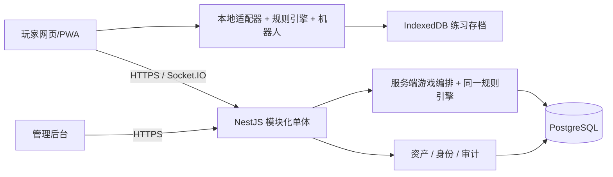

# 炸金花技术方案 V1.0

依赖产品基线见 [需求设计](./01-需求设计.md)。本方案是推荐实现，不表示已有运行中的系统。项目当前为空目录，不因目录位于 PyCharm 工程路径而假定必须使用 Python。

## 1. 技术选择

推荐 TypeScript 全栈，让单机与联机复用同一套规则代码。首期使用模块化单体，不拆微服务。

| 层次 | 推荐 | 用途 |
|---|---|---|
| 玩家端 | Vue 3、TypeScript、Vite、Pinia | 响应式页面、牌桌状态与动画 |
| 离线能力 | PWA / Service Worker、IndexedDB | 缓存程序与保存单机局 |
| 管理端 | Vue 3、Element Plus | 成员、账本、配置、审计 |
| 服务端 | Node.js 支持中的 LTS、NestJS | 身份、房间、游戏、资产与管理 API |
| 实时通信 | Socket.IO | 房间事件、操作确认、重连 |
| 数据库 | PostgreSQL | 账号、资产账本、游戏状态、审计 |
| 数据访问 | Prisma + 必要的参数化 SQL | 迁移、常规查询、显式行锁 |
| 可选组件 | Redis，MVP 非必需 | 多实例阶段的在线状态和限速共享 |
| 测试 | Vitest、Playwright | 规则、服务集成、多浏览器验收 |
| 部署 | Docker Compose、Caddy 或 Nginx | 单机部署、HTTPS、反向代理 |

具体依赖版本在开发启动时选择兼容稳定版本、固定 lockfile，并核对支持周期。NestJS 提供 WebSocket Gateway 和 Socket.IO 适配能力，参见[官方文档](https://docs.nestjs.com/websockets/gateways)。PWA 的 manifest 与 Service Worker 用于离线体验，参见[Vite PWA 文档](https://vite-pwa-org.netlify.app/guide/)。

若团队只熟悉 Python，可选 FastAPI + WebSocket + PostgreSQL，但需维护浏览器 TypeScript 与 Python 两套引擎并通过相同测试向量验证一致性，因此不作为当前首选。

## 2. 架构与职责



引擎只做确定性计算：给定状态、合法动作和明确随机输入，产生新状态与事件。不依赖数据库、网络、UI 或系统时间。服务端负责编排、权限、时钟、随机源、事务和持久化；客户端从不决定联机赢家或余额。

```text
apps/
  player-web/           玩家端与离线入口
  admin-web/            管理端
  server/               NestJS 服务端
packages/
  game-core/            牌型、比较、回合状态机、合法动作
  game-ai/              只接收机器人可见信息的决策模块
  protocol/             消息结构、错误码、运行时校验 schema
  test-vectors/         固定牌局、规则边界与可重放动作
docs/
```

## 3. 引擎与状态机

牌用 0～51 的整数编码，点数和花色通过纯函数转换；牌型比较返回稳定的可比较元组。顺子为 A23 特别指定最低序号，不能直接按 A=14 排序推断。

```text
房间: WAITING → COUNTDOWN → PLAYING → WAITING → CLOSED
牌局: CREATED → PLAYING → SETTLED
                      └→ VOIDED
玩家局内状态: ACTIVE_BLIND / ACTIVE_SEEN / FOLDED / ELIMINATED
```

SETTLED 和 VOIDED 均不可逆，只有一个终态。最后一项操作及其触发的结算在同一事务内完成，避免“最后动作成功但结算遗失”。

核心接口建议：

```ts
evaluateHand(cards): HandRank
compareHands(a, b, rule): -1 | 0 | 1
listLegalActions(state, playerId): LegalAction[]
applyAction(state, command): { state, events, transfers }
buildPlayerView(state, playerId): PlayerView
```

命令类型为 LOOK、FOLD、CALL、RAISE、COMPARE、TIMEOUT。RAISE 传档位，COMPARE 传目标 ID；下注金额由引擎计算。TIMEOUT 仅内部调度器可产生。定时器携带 handId、turnId 和 deadline，数据库事务中再次确认，旧定时器不能弃掉新回合的玩家。

牌局状态包含 deck、hands、ruleSnapshot、dealerSeat、roundQueue、roundNo、turnId、actorId、deadline、q、pot 和版本号。只有服务端完整状态包含隐藏牌；持久化事件和对外事件使用不同类型，不直接把数据库对象序列化到客户端。

## 4. 数据模型

所有主键推荐 UUID；所有时间保存 UTC；金额 BIGINT，跨 JSON 边界传十进制字符串，避免 JavaScript 精度丢失；游戏参数限制在安全整数范围内并严格验证。

| 表 | 核心字段与约束 |
|---|---|
| users | id、username_normalized 唯一、password_hash、nickname、status |
| roles / user_roles | RBAC 角色与账号关联 |
| sessions | user_id、token_hash、expires_at、revoked_at、session_generation |
| invite_codes | code_hash、expires_at、max_uses、used_count |
| ledger_accounts | owner、kind、balance、version；玩家钱包/桌上/底池非负 |
| ledger_transactions | id、business_key 唯一、type、operator、reason、reversal_of |
| ledger_entries | transaction_id、account_id、signed_amount、balance_after |
| rooms | id、code 唯一、host_id、status、template_id、version |
| room_seats | room_id、seat_no 唯一、user_id、ready、leave_pending、table_account_id |
| hands | room_id、status、version、rule_snapshot、private_state、started_at、ended_at |
| hand_players | hand_id、user_id、seat、contribution、net_change、final_status |
| game_commands | user_id + request_id 唯一、payload_hash、status、result |
| game_events | hand_id + seq 唯一、type、内部 payload |
| outbox_events | committed event、delivery_status、attempt_count |
| asset_adjustments | operator、target、amount、reason、business_key、ledger_tx_id |
| admin_daily_usage | operator + date 唯一、used_amount；额度判断时加锁 |
| audit_logs | actor、action、target、request_id、脱敏前后值、timestamp |
| rule_templates / settings | schema_version、version、配置、修改人 |

以数据库约束确保同一成员只能有一个有效座位、同一房间只能有一个活动牌局，可使用局部唯一索引。资产对象采用确定的业务 ID，避免账号在同一房间被重复创建。

## 5. 资产一致性

采用不可变交易流水加账户余额。每笔交易的 entries 金额代数和为 0。系统发行账户允许负数以表示发行量，普通玩家账户与底池账户禁止负数。

| 业务 | 资金移动 |
|---|---|
| 注册初始发放 / 管理员增发 | 系统发行账户 → 玩家钱包 |
| 管理员扣减 | 玩家钱包 → 系统回收账户 |
| 带入 / 离桌 | 钱包 ↔ 桌上账户 |
| 底注 / 跟注 / 加注 / 比牌 | 桌上账户 → 本局底池 |
| 正常结算 | 底池 → 赢家桌上账户 |
| 异常撤销 | 底池 → 每位玩家桌上账户，按本局实际累计投入退款 |

示例：A、B 各带入 2,000，本局分别投入 100、200，A 获胜。最终桌上 A=2,200、B=1,800、底池=0，总和仍为 4,000；带入和退回本身不算输赢。

一次下注事务流程：

1. 依据已鉴权身份读取命令幂等键；重复键且 payload 相同则返回原结果，不同则拒绝。
2. 锁定房间/牌局行，校验版本、当前行动者、session_generation 和服务端截止时间。
3. 按统一顺序锁定涉及的账户行，计算合法动作，校验余额。
4. 写入账本交易与分录、更新余额、牌局状态和内部事件；若达终局，同事务结算。
5. 写命令结果和 outbox 事件，提交后才响应和广播。

所有业务遵循固定锁顺序（额度记录 → 房间/牌局 → 按 ID 排序的账户）；未涉及的锁跳过。唯一约束作为并发幂等的最后防线，冲突或死锁按有限次数重试。PostgreSQL 的行锁支持该方案，参见[显式锁文档](https://www.postgresql.org/docs/17/explicit-locking.html)。

注册发币业务键 initial:userId；结算键 settle:handId；撤销键 void:handId；调账由客户端提供随机请求 ID。结算与撤销竞争时，持有同一牌局锁并检查终态，因此不能各执行一次。

每日及启动时核对：账户余额等于分录累加、每笔分录和为 0、进行中底池等于投入和、终局底池为 0。出现不一致时暂停相关房间资产操作并告警，不自动补差掩盖错误。

## 6. 通信与接口

REST 用于账号、列表、查询和后台；Socket.IO 用于房间操作、回合指令和状态同步。传输机制不能替代业务幂等与持久化。

| REST 接口 | 作用 |
|---|---|
| POST /api/auth/register, /login, /logout | 账号入口 |
| GET /api/me, /api/me/ledger, /api/me/hands | 个人资料、流水、战绩 |
| POST /api/rooms | 创建房间 |
| GET /api/room-templates | 查询可用模板 |
| GET /api/admin/users, /ledger, /audit-logs | 后台查询 |
| POST /api/admin/users/:id/status | 禁用/启用 |
| POST /api/admin/users/:id/reset-token | 密码重置凭证 |
| POST /api/admin/asset-adjustments | 调账 |
| POST /api/admin/rooms/:id/close | 结束后关闭或异常撤销 |

客户端事件：room.join、room.leave、seat.ready、seat.topup、game.action、state.sync。
服务端事件：room.snapshot、game.snapshot、game.patch、game.finished、wallet.changed、session.revoked、command.result。

```json
{
  "requestId": "uuid",
  "roomId": "uuid",
  "handId": "uuid",
  "expectedVersion": 17,
  "turnId": "uuid",
  "type": "RAISE",
  "payload": { "level": 5 }
}
```

服务端从会话推导 userId，不能信任消息中的身份、余额、牌或客户端时间。返回 requestId、code、version 和结果。错误码包括 NOT_YOUR_TURN、STALE_STATE、INSUFFICIENT_BALANCE、ACTION_NOT_ALLOWED、ACCOUNT_DISABLED。

每个玩家收到独立的可见快照：自己看牌后才包含自己的牌值，其他玩家仅含牌背与公开状态。全房间广播只用于已脱敏公共信息。管理员读接口也执行相同隐藏信息约束。

首次加入和重连默认直接发完整可见快照，含 serverTime 和 deadline。小型回合游戏不必优先实现复杂事件补发；客户端发现版本跳跃即重新同步。界面倒计时用服务器时间偏差估算，超时判断只由服务端决定。

## 7. 单机、随机与安全

- 单机通过 LocalGameAdapter 调用同一引擎，联机通过 RemoteGameAdapter 发命令；页面仅依赖统一 view 与 action 接口。
- 本地存档包含 schemaVersion、ruleVersion；机器人决策放入 Web Worker，避免阻塞动画。
- 服务端采用 Fisher–Yates 洗牌，各步使用操作系统加密随机源提供无偏随机整数；测试注入可复现随机源，生产拒绝测试种子。
- 单机客户端有完整牌组是离线运行的必要条件，因此其币和成绩不参与联机权益。
- 密码使用 Argon2id 等成熟库的密码哈希；会话令牌仅保存哈希，浏览器用 Secure、HttpOnly、SameSite Cookie；写操作校验 CSRF，Socket 握手校验 Origin 和会话。
- 注销、禁用和替换会话立即撤销操作权，每个 Socket 命令都验证有效会话，不能只在建立连接时验证。
- 登录、邀请码、房间码和管理写操作限速；昵称等输入校验并转义输出；不记录密码、会话令牌和底牌到普通日志。
- 敏感牌局状态以应用层加密保存，密钥在服务端秘密配置中；常规后台不返回原始事件与私有状态。拥有生产主机/数据库密钥的运维仍属于可信边界，应用权限不能替代主机安全。
- 静态 PWA 缓存不得缓存个人资产和后台 API；检测新版时提示局后刷新，避免局中强制更新。已登录账号的私人数据不作为公共离线缓存。

## 8. 持久化、重启与部署

MVP 一个游戏服务实例拥有全部房间，不使用 Redis 内存状态作为余额或牌局真相。数据库每次接受动作时持久化完整状态及事件。

启动恢复顺序：阻止新对局 → 检查账目 → 对遗留 PLAYING 局加锁并执行 VOIDED 退款 → 退还/清理无主桌上账户 → 恢复服务。已经 SETTLED 的局绝不退款，客户端收到对应终态。该策略牺牲未完成局的连续性，换取首版明确、可验证的资产结果；后续版本再做牌局续跑。

outbox 提交后由后台任务投递通知，允许重复投递，客户端按版本去重；漏收时快照同步。不能把“数据库已提交但尚未广播”当成失败并反向扣款。

部署建议：玩家端和管理端静态文件由反向代理服务；/api 与 Socket 路径转发到应用；数据库不暴露公网；HTTPS/WSS；配置通过环境变量和部署密钥注入。初期可按 4 vCPU、8 GB 内存作为压测起点，不作为容量保证。

备份建议：每日全量加 WAL 归档，目标 RPO ≤ 15 分钟、RTO ≤ 2 小时，必须以实际恢复演练验证。恢复数据库备份可能丢失备份点之后的已确认交易，需要停服核对和明确报告恢复时间点，不声称恢复后天然零丢失。

监控关注连接数、活动牌桌数、命令延迟、事务失败、重复请求、重连率、结算失败、账目差异和 outbox 积压。日志关联 requestId、handId、ledgerTransactionId，不泄露手牌与凭据。

扩容到多游戏实例前，必须先增加房间归属、带 fencing token 的租约、共享限速和跨实例路由，并重新设计重启恢复范围，不能启动多个实例各自撤销所有 PLAYING 局。广播适配器本身不保证回合串行或资产一致。

## 9. 测试与交付

| 层次 | 必测内容 |
|---|---|
| 引擎单测 | 全牌型、A23、平局、看牌倍率、比牌、轮次、强制终局 |
| 性质测试 | 52 张无重复、三张组合枚举分类、比较反对称/传递、资产守恒 |
| 数据库集成 | 重复注册、邀请码并发、幂等、并发调账、终局竞争、额度限制 |
| 多客户端 E2E | 2～6 人开局、刷新重连、超时、退出、冻结、换设备 |
| 权限与信息 | 越权调账、Socket 会话撤销、跨房间访问、底牌不泄露 |
| 故障注入 | 提交前后中断、广播中断、DB 不可用、服务重启退款 |
| 压测 | 300 连接、50 桌同时行动、重连突发、后台查询并发 |

性能目标为同部署区域、健康网络下服务端命令处理 P95 < 200ms、端到端确认 P95 < 500ms；以明确机器配置、持续至少 30 分钟的混合负载验收，不将目标当作已实测结果。

建议由 1 名有相关经验的全栈开发按 5～7 周估算，具体取决于视觉精度和测试投入：

1. 第 1 周：冻结规则、页面线框、数据库、引擎与测试向量。
2. 第 2 周：单机闭环、机器人、存档、牌桌基础交互。
3. 第 3～4 周：账号、账本、房间、联机回合、结算与重连。
4. 第 5 周：管理后台、权限、调账、审计与异常撤销。
5. 第 6～7 周：故障测试、压测、手机适配、部署与备份恢复演练。

交付物：源码、数据库迁移、配置示例、部署脚本、初始管理员创建命令、OpenAPI/消息协议、规则测试、验收记录、备份恢复操作说明。达到可运行不等于达到可上线，资产一致性与故障恢复验收是完成标准。
